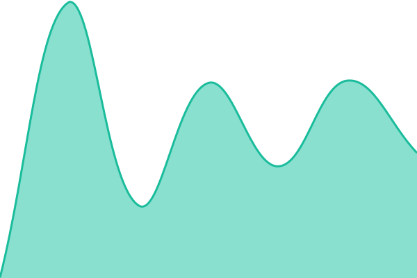
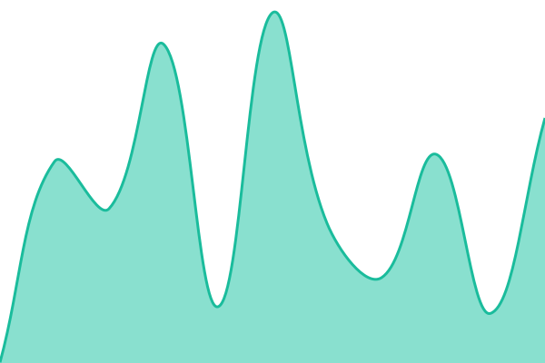
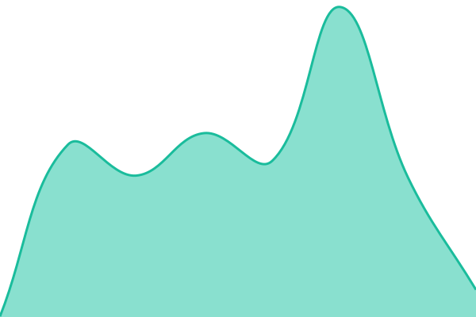
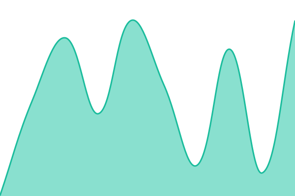
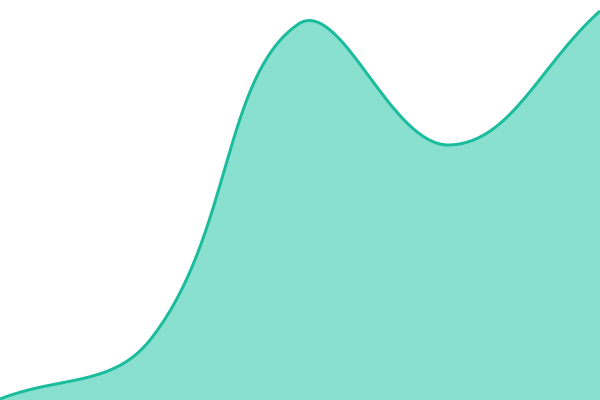
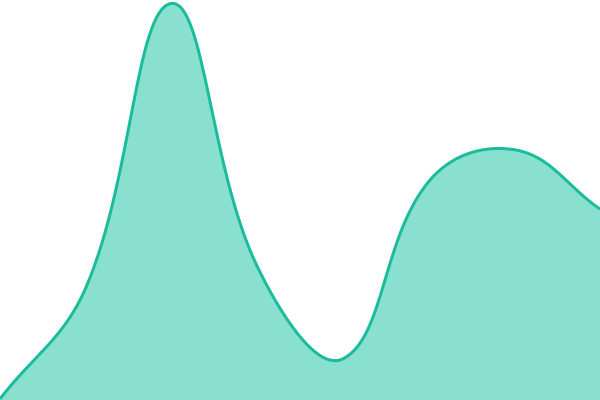
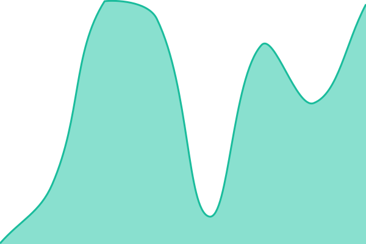
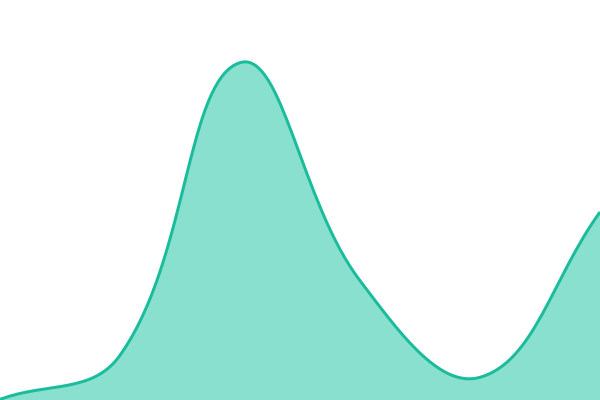
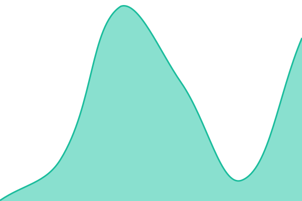

# [📈 Live Status](https://upptime.wglab.org): <!--live status--> **🟩 All systems operational**

This repository contains the open-source uptime monitor and status page for [Upptime](https://upptime.js.org), powered by [Upptime](https://github.com/upptime/upptime).

With [Upptime](https://upptime.js.org), you can get your own unlimited and free uptime monitor and status page, powered entirely by a GitHub repository. We use [Issues](https://github.com/upptime/upptime/issues) as incident reports, [Actions](https://github.com/upptime/upptime/actions) as uptime monitors, and [Pages](https://upptime.wglab.org) for the status page.

<!--start: status pages-->
<!-- This summary is generated by Upptime (https://github.com/upptime/upptime) -->
<!-- Do not edit this manually, your changes will be overwritten -->
<!-- prettier-ignore -->
| URL | Status | History | Response Time | Uptime |
| --- | ------ | ------- | ------------- | ------ |
|  [ANNOVAR](https://annovar.openbioinformatics.org/) | 🟩 Up | [annovar.yml](https://github.com/WGLab/upptime/commits/HEAD/history/annovar.yml) | 

 352ms
     
 | 

<a href="https://upptime.wglab.org/history/annovar">100.00%</a>
    

|  [PennCNV](https://penncnv.openbioinformatics.org/) | 🟩 Up | [penn-cnv.yml](https://github.com/WGLab/upptime/commits/HEAD/history/penn-cnv.yml) | 

 372ms
     
 | 

<a href="https://upptime.wglab.org/history/penn-cnv">100.00%</a>
    

|  [GenGen](https://gengen.openbioinformatics.org/) | 🟩 Up | [gen-gen.yml](https://github.com/WGLab/upptime/commits/HEAD/history/gen-gen.yml) | 

 295ms
     
 | 

<a href="https://upptime.wglab.org/history/gen-gen">100.00%</a>
    

|  [PubMind](https://pubmind.wglab.org) | 🟩 Up | [pub-mind.yml](https://github.com/WGLab/upptime/commits/HEAD/history/pub-mind.yml) | 

 313ms
     
 | 

<a href="https://upptime.wglab.org/history/pub-mind">100.00%</a>
    

|  [PhenoSV](https://phenosv.wglab.org) | 🟩 Up | [pheno-sv.yml](https://github.com/WGLab/upptime/commits/HEAD/history/pheno-sv.yml) | 

 258ms
     
 | 

<a href="https://upptime.wglab.org/history/pheno-sv">100.00%</a>
    

|  [Doc2HPO](https://doc2hpo.wglab.org) | 🟩 Up | [doc2-hpo.yml](https://github.com/WGLab/upptime/commits/HEAD/history/doc2-hpo.yml) | 

 263ms
     
 | 

<a href="https://upptime.wglab.org/history/doc2-hpo">100.00%</a>
    

|  [Phen2Gene](https://phen2gene.wglab.org) | 🟩 Up | [phen2-gene.yml](https://github.com/WGLab/upptime/commits/HEAD/history/phen2-gene.yml) | 

 248ms
     
 | 

<a href="https://upptime.wglab.org/history/phen2-gene">100.00%</a>
    

|  [PDIDB](https://pdidb.wglab.org) | 🟩 Up | [pdidb.yml](https://github.com/WGLab/upptime/commits/HEAD/history/pdidb.yml) | 

 158ms
     
 | 

<a href="https://upptime.wglab.org/history/pdidb">100.00%</a>
    

|  [wANNOVAR](https://wannovar.wglab.org) | 🟩 Up | [w-annovar.yml](https://github.com/WGLab/upptime/commits/HEAD/history/w-annovar.yml) | 

 247ms
     
 | 

<a href="https://upptime.wglab.org/history/w-annovar">100.00%</a>
    

|  [Phenolyzer](https://phenolyzer.wglab.org) | 🟩 Up | [phenolyzer.yml](https://github.com/WGLab/upptime/commits/HEAD/history/phenolyzer.yml) | 

 214ms
     
 | 

<a href="https://upptime.wglab.org/history/phenolyzer">100.00%</a>
    

|  [wInterVar](https://wintervar.wglab.org) | 🟩 Up | [w-inter-var.yml](https://github.com/WGLab/upptime/commits/HEAD/history/w-inter-var.yml) | 

 187ms
     
 | 

<a href="https://upptime.wglab.org/history/w-inter-var">100.00%</a>
    

|  [CancerVar](https://cancervar.wglab.org) | 🟩 Up | [cancer-var.yml](https://github.com/WGLab/upptime/commits/HEAD/history/cancer-var.yml) | 

 182ms
     
 | 

<a href="https://upptime.wglab.org/history/cancer-var">100.00%</a>
    

|  [HX1](https://hx1.wglab.org) | 🟩 Up | [hx-1.yml](https://github.com/WGLab/upptime/commits/HEAD/history/hx-1.yml) | 

 110ms
     
 | 

<a href="https://upptime.wglab.org/history/hx-1">100.00%</a>
    

|  [SeqMule](https://seqmule.openbioinformatics.org) | 🟩 Up | [seq-mule.yml](https://github.com/WGLab/upptime/commits/HEAD/history/seq-mule.yml) | 

 433ms
     
 | 

<a href="https://upptime.wglab.org/history/seq-mule">100.00%</a>
    

<!--end: status pages-->

[**Visit our status website →**](https://upptime.wglab.org)

## 📄 License

- Powered by: [Upptime](https://github.com/upptime/upptime)
- Code: [MIT](./LICENSE) © [Anand Chowdhary](https://anandchowdhary.com)
- Data in the `./history` directory: [Open Database License](https://opendatacommons.org/licenses/odbl/1-0/)
